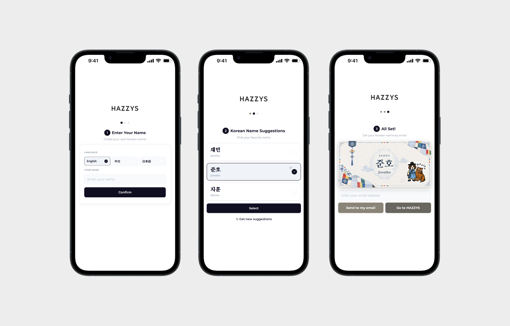

<div align="left">

<p></p>
</div>

> 이 저장소는 실무 프로젝트를 포트폴리오용으로 재현한 데모이며, 실제 이벤트 페이지와 무관합니다.

## 📝 프로젝트 소개
HAZZYS 나만의 한글 이름 짓기는 외국인 방문객이 자신의 이름을 입력하면<br />
발음이 비슷한 한글 이름 3개를 추천받고, 고른 이름을 카드 이미지로 이메일을 통해 받아볼 수 있는 이벤트 페이지입니다.
<br />
<br />
(주)네오엠씨 재직 중 디자인과 퍼블리싱을 담당했으며, 워드프레스 코드 스니펫으로 REST API를 만들어 <br />
Claude API를 연동했습니다. 이름 생성 규칙은 별도 스킬 파일로 분리하고, AI가 만든 결과는 서버에서 <br />
규칙 기반으로 한 번 더 검증해 실제 한국 이름처럼 자연스러운 이름만 보여주도록 구성했습니다.<br />

## 🗓 프로젝트 일정
**총 일정 2026.09 ~ 2026.10, 1인**
<br /><br />
기획 및 디자인 (Figma)
<br />
워드프레스 페이지 퍼블리싱 및 다국어 페이지 구성 (영어·중국어·일본어)
<br />
이름 생성 API 및 검증 로직 개발
<br />
카드 이미지 생성 및 이메일 발송 연동, 점검 및 오류 수정

## 🔗 배포 URL
실무 페이지는 회사 API를 사용하고 있어 링크를 공개하지 않습니다.<br />
포트폴리오용 재현 데모: <a href="https://hazzys-kname-demo.vercel.app/" target="_blank">https://hazzys-kname-demo.vercel.app/</a>
<br />


## 🖥 화면 구성


## ⚙ 기술 스택
이 프로젝트는 다음 기술을 활용하여 구현되었습니다.

- **WordPress**: 이벤트 페이지 제작 및 운영
- **Code Snippets (PHP)**: REST API 엔드포인트, 이름 검증 로직, 화면 CSS·JS 출력을 하나의 스니펫으로 관리
- **Formidable Forms**: 이메일 주소와 이름 카드 이미지를 받아 메일 발송
- **Claude API (모델: Haiku 4.5)**: 입력한 이름과 발음이 비슷한 한글 이름 후보 생성
- **html2canvas**: 이름 카드 화면을 이미지로 변환
- **Figma**: 화면 디자인
<br />

## 🛠 주요 기능 및 특징
1. **이름 입력 (1단계)**:
   - 영어·중국어·일본어 페이지를 Polylang으로 나누고, 언어 탭을 누르면 해당 언어 페이지로 이동합니다.
   - 페이지 언어에 맞는 글자만 입력되었는지 화면과 서버에서 모두 검사합니다. (영어는 알파벳, 중국어는 한자, 일본어는 한자·가나)

2. **한글 이름 추천 (2단계)**:
   - 워드프레스 REST API(`kname/v1/generate`)가 Claude API를 호출해 이름 후보를 만들고, 검증을 통과한 3개를 보여줍니다.
   - 영어는 로마자, 중국어는 한자, 일본어는 가타카나로 읽는 법을 함께 보여줍니다.
   - 이름을 선택하면 두 번째 카드는 하트, 나머지는 별 아이콘이 표시됩니다.
   - **다시 추천받기**를 누르면 이미 보여준 이름을 제외하고 새로 추천합니다.

3. **이름 카드 및 이메일 발송 (3단계)**:
   - 선택한 이름을 한지·달항아리 배경의 명함 카드로 보여주고, html2canvas로 카드 이미지를 만듭니다.
   - 이메일을 입력하면 Formidable Forms 숨김 필드에 이름, 카드 이미지, 언어를 담아 전송합니다.
   - 메일 제목과 인사말은 방문자 언어에 맞춰 바뀌고, 카드 이미지는 메일 본문에 바로 보이도록 첨부됩니다.

4. **운영 관리**:
   - 이름 생성 규칙(프롬프트)은 스킬 파일(`korean-name-generator_v7.md`)로 분리해, 코드를 고치지 않고 파일만 바꿔 규칙을 수정할 수 있습니다.
   - 같은 이름으로 검증을 통과한 후보는 30일간 저장해 다음 요청에는 API를 호출하지 않습니다.
<br />

## 🤔 기술적 이슈와 해결 과정

### 1. **AI가 외국 이름을 한글로 옮겨 적거나 어색한 이름을 만드는 문제**

 - 문제: 모델이 실제 이름 대신 외국 이름을 한글로 옮겨 적거나(토마, 케빈, 제임스), 성과 이름을 합친 세 글자, 실제로 쓰이지 않는 음절 조합을 만드는 경우가 있었습니다.

 - 해결: 서버에서 결과를 다시 검증하도록 했습니다. 정확히 한글 두 글자인지, 외래어 표기에 쓰이는 "자음 + ㅡ" 글자(트, 크, 스 등)가 없는지, 실제 이름에 쓰이는 **허용 음절 목록**에 있는지 확인합니다. 허용 음절 목록은 스킬 파일에 한 번만 적어 두고, 프롬프트와 서버 검증이 같은 목록을 읽도록 해 두 곳이 어긋나지 않게 했습니다. 규칙을 통과한 후보도 AI에게 한 번 더 판정하게 해(2차 검증) 어색한 이름을 걸러냈습니다.

### 2. **AI가 만든 로마자 표기가 틀리는 문제**

 - 문제: 한글 이름은 맞게 만들어도 로마자 표기의 받침이나 모음을 잘못 적는 경우가 있었습니다. (하은 → Haeum, 도원 → Doyeon)

 - 해결: 로마자는 모델 값을 쓰지 않고, 한글을 초성·중성·종성으로 분해해 **코드로 직접 계산**했습니다. 국어의 로마자 표기법을 기본으로 하되 연음 규칙과 실제로 많이 쓰는 표기(우 → woo, 영 → young)를 반영했습니다. 한자와 가타카나는 규칙으로 계산할 수 없어서 모델 값을 쓰되, 다른 문자로 적었는지만 확인했습니다.

### 3. **API 비용과 응답 속도**

 - 문제: 방문자가 같은 이름을 입력해도 매번 API를 호출해 비용과 대기 시간이 발생했습니다.

 - 해결: 워드프레스 **transient**에 검증된 후보를 30일간 저장해, 같은 이름은 API 없이 섞어서 보여주도록 했습니다. 저장 키는 "입력 이름 + 표기 방식 + 스킬 파일 내용"의 해시로 만들어, 입력한 이름 원문은 저장하지 않고 스킬 파일을 수정하면 예전 캐시가 자동으로 쓰이지 않게 했습니다.

### 5. **캐시된 페이지에서 보안 토큰(nonce)이 만료되는 문제**

 - 문제: 페이지가 오래 열려 있거나 캐시된 경우 REST API 요청에 쓰는 nonce가 만료되어 요청이 거부되었습니다.

 - 해결: 새 nonce를 받는 엔드포인트를 따로 만들어, 만료 응답(403)을 받으면 새 nonce로 한 번만 자동 재시도하도록 처리했습니다.
<br />

##  :file_folder: 구성
<pre class="notranslate">
<code>
📦WordPress (실무)
 ┣ 📂ai
 ┃ ┗ 📜korean-name-generator_v7.md   # 이름 생성 프롬프트
 ┣ 📜kname-snippet.php               # Code Snippets
 ┃ ┣ 언어 감지·다국어 문구           # Polylang 플러그인 사용
 ┃ ┣ REST API                        # kname/v1/generate, kname/v1/nonce
 ┃ ┣ 이름 검증·로마자 변환·캐시
 ┃ ┣ CSS·JS 출력                     # 화면, 카드 캡처
 ┃ ┗ 이메일 처리                     # Formidable 메일·이름·이미지 첨부
 ┗ 📂페이지                          # k-name / k-name-cn / k-name-jp (언어별 HTML 페이지)
</code>
</pre>

<br />

## 📦 포트폴리오 재현 데모
실무 페이지는 회사 API를 사용해 공개할 수 없어서, 같은 흐름을 **Next.js**로 다시 구현해 배포했습니다.

| 실무 (WordPress) | 데모 (이 저장소) |
|---|---|
| 코드 스니펫 REST API (PHP) | `app/api/generate/route.js`, `lib/generate.js` |
| 검증·로마자 변환 (PHP) | `lib/kname.js` |
| 캐시 | Upstash Redis 캐시 |
| nonce | IP당 하루 10회 사용 제한 (Upstash Redis) |
| Polylang 언어별 페이지 | 한 페이지에서 언어 탭 전환 (`?lang=zh`) |
| Formidable 이메일 발송 | 카드 이미지 저장 |

데모는 API 비용을 줄이기 위해 프롬프트를 축약하고 후보를 3개만 받으며, 2차 검증은 끄고 재시도는 최대 2번으로 줄였습니다.

<!-- ```bash
npm install
cp .env.example .env    # ANTHROPIC_API_KEY 입력
npm run dev
```
API 비용 없이 화면만 확인하려면 `.env`에 `KNAME_MOCK=1`을 추가합니다. -->
